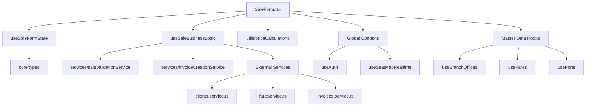

# Refactorización Modular del Sistema de Ventas

## 📁 Estructura Modular Propuesta

```
src/features/fluvial/components/sales-point/
├── 📁 core/
│   └── types.ts                     # Interfaces y tipos centralizados
├── 📁 utils/
│   └── priceCalculations.ts         # Cálculos de precios y validaciones
├── 📁 services/
│   ├── saleValidationService.ts     # Validaciones de negocio
│   └── invoiceCreationService.ts    # Lógica de creación de facturas
├── 📁 hooks/
│   ├── useSaleFormState.ts          # Estado del formulario
│   └── useSaleBusinessLogic.ts      # Lógica de negocio de ventas
├── 📁 representatives/              # Ya existente
├── SaleForm.tsx                     # Componente principal (REDUCIDO)
├── PassengerDataForm.tsx            # Componente de datos del pasajero
├── SeatAndFareSelector.tsx          # Selector de asientos y tarifas
├── PriceSummary.tsx                 # Resumen de precios
├── ReservationModal.tsx             # Modal de reservas
└── index.ts                         # Exportaciones centralizadas
```

## 🎯 Beneficios de la Refactorización

### ✅ **Separación de Responsabilidades**
- **Core**: Tipos y interfaces reutilizables
- **Utils**: Funciones puras de cálculo sin efectos secundarios
- **Services**: Lógica de negocio y validaciones
- **Hooks**: Estado y efectos reactivos

### ✅ **Mejor Mantenimiento**
- Cada archivo tiene una responsabilidad específica
- Fácil localización de bugs y nuevas funcionalidades
- Testing más granular por módulo

### ✅ **Reutilización**
- Funciones de cálculo reutilizables en otros componentes
- Servicios que pueden usarse en diferentes partes del sistema
- Hooks personalizados para lógica compleja

### ✅ **Escalabilidad**
- Estructura preparada para crecimiento del sistema
- Nuevas funcionalidades se agregan en módulos específicos
- Arquitectura que soporta múltiples desarrolladores

## 📋 Migración Sugerida

### Fase 1: Integración Gradual
1. Mantener `SaleForm.tsx` actual
2. Importar y usar servicios modulares gradualmente
3. Reemplazar lógica inline con funciones de los servicios

### Fase 2: Refactorización Completa
1. Migrar estado a `useSaleFormState`
2. Migrar lógica de negocio a `useSaleBusinessLogic`
3. Limpiar componente principal

### Fase 3: Optimización
1. Testing unitario por módulo
2. Documentación de APIs
3. Performance optimizations

## 🔧 Ejemplo de Uso

```typescript
// Antes (todo en SaleForm.tsx - 1000+ líneas)
const SaleForm = () => {
  // 50+ useState
  // 20+ useEffect
  // 500+ líneas de lógica de negocio
  // 300+ líneas de validaciones
  // 200+ líneas de cálculos
}

// Después (SaleForm.tsx limpio - ~300 líneas)
const SaleForm = () => {
  const { state, updateState } = useSaleFormState();
  const { handleRegularSale, handleCompanySale } = useSaleBusinessLogic({...});
  const pricing = calculatePriceDetails(...);
  
  return (
    // Solo JSX y eventos simples
  );
}
```

## 🚀 Funcionalidades Limpias

### Sin Logs de Debug
- ✅ Eliminados todos los `console.log`
- ✅ Removidos botones de testing/debug
- ✅ Código limpio para producción

### Funciones Puras
- ✅ Cálculos de precios sin efectos secundarios
- ✅ Validaciones reutilizables
- ✅ Servicios testeable unitariamente

## 📊 Métricas de Mejora

| Métrica | Antes | Después |
|---------|--------|---------|
| Líneas por archivo | 1000+ | ~300 |
| Responsabilidades | 8+ | 1 |
| Testabilidad | Baja | Alta |
| Reutilización | Baja | Alta |
| Mantenibilidad | Baja | Alta |

## 🔗 Dependencias y Contexto del SaleForm

### 📁 **Contextos Globales**
El SaleForm depende de varios contextos ubicados en diferentes niveles de la aplicación:

```typescript
// 🌐 Contexto Global de Autenticación
src/features/auth/hooks/useAuth.ts
├── Proporciona: Usuario actual, branch office, permisos
├── Usado en: Validaciones de acceso, datos de usuario
└── Estado: selectedBranchOffice, currentUser

// 🎯 Contexto de Reservas en Tiempo Real
src/features/fluvial/hooks/useSeatMapRealtime.ts
├── Proporciona: Estado de asientos en tiempo real
├── WebSocket: Actualizaciones de reservas instantáneas
└── Usado en: SeatAndFareSelector, validaciones de disponibilidad
```

### 🗂️ **Servicios Externos Consumidos**
```typescript
// 📍 Servicios de Ubicación Geográfica
src/services/
├── countries.service.ts        # Países y departamentos
├── ports.cities.service.ts     # Puertos y ciudades
└── geonames.service.ts         # Datos geográficos externos

// 💰 Servicios de Tarifas y Precios
src/services/
├── fareService.ts              # Tarifas por ruta y tipo de asiento
├── routes.service.ts           # Rutas disponibles
└── trips.service.ts            # Viajes programados

// 👥 Servicios de Clientes y Representantes
src/services/
├── clients.service.ts          # Gestión de clientes
├── representantes.service.ts   # Representantes autorizados
└── companies.service.ts        # Empresas para ventas corporativas

// 🧾 Servicios de Facturación
src/services/
├── invoices.service.ts         # Creación de facturas
├── documentSeries.service.ts   # Series de documentos
└── remissionGuides.service.ts  # Guías de remisión
```

### 🎯 **Hooks Especializados**
```typescript
// 🏢 Datos Maestros
src/hooks/
├── useBranchOffices.ts         # Sucursales disponibles
├── useCitiesPortsData.ts       # Ciudades y puertos
├── useDocumentSeries.ts        # Series documentarias
├── useFares.ts                 # Tarifas por ruta
└── usePorts.ts                 # Información de puertos

// 🚢 Específicos de Fluvial
src/features/fluvial/hooks/
├── useTrips.ts                 # Gestión de viajes
├── useVessels.ts               # Información de embarcaciones
└── useSeatMapRealtime.ts       # Estado de asientos en tiempo real
```

### 🔧 **Módulos Internos de SaleForm**
```typescript
// 📋 Tipos y Configuración
./core/types.ts
├── PassengerData: Estructura de datos del pasajero
├── Representative: Datos del representante
├── SaleFormProps: Props del componente principal
└── initialPassengerData: Estado inicial del formulario

// 🧮 Utilidades de Cálculo
./utils/priceCalculations.ts
├── calculatePriceDetails(): Cálculo completo de precios
├── validateDiscount(): Validación de descuentos
├── calculateTotalWithTax(): Cálculo con impuestos
└── formatPriceDisplay(): Formateo de precios

// ✅ Servicios de Validación
./services/saleValidationService.ts
├── validatePassengerData(): Validación de datos del pasajero
├── validateSeatSelection(): Validación de selección de asientos
├── validatePaymentMethod(): Validación de método de pago
└── validateBusinessRules(): Reglas de negocio específicas

// 🧾 Servicios de Facturación
./services/invoiceCreationService.ts
├── createRegularInvoice(): Facturas normales
├── createCompanyInvoice(): Facturas para empresas
├── generateDocumentSeries(): Generación de series
└── validateInvoiceData(): Validación de datos de factura

// 🎯 Hooks de Estado y Lógica
./hooks/useSaleFormState.ts
├── Estado: Formulario, pasajeros, precios, errores
├── Acciones: updatePassenger, setSelectedSeats, etc.
└── Validaciones: Estado consistente del formulario

./hooks/useSaleBusinessLogic.ts
├── handleRegularSale(): Lógica de venta normal
├── handleCompanySale(): Lógica de venta empresarial
├── processPayment(): Procesamiento de pagos
└── generateReservation(): Creación de reservas
```

### 🔄 **Flujo de Dependencias**


### 🚀 **Implementaciones Futuras**
Para nuevas funcionalidades, seguir este patrón:

1. **Nuevos Tipos**: Agregar en `core/types.ts`
2. **Nuevas Validaciones**: Extender `services/saleValidationService.ts`
3. **Nuevos Cálculos**: Agregar en `utils/priceCalculations.ts`
4. **Nueva Lógica de Negocio**: Extender `hooks/useSaleBusinessLogic.ts`
5. **Nuevos Servicios Externos**: Crear en `src/services/`

Esta arquitectura garantiza que cada nueva funcionalidad tenga un lugar específico y no rompa la estructura modular existente.
